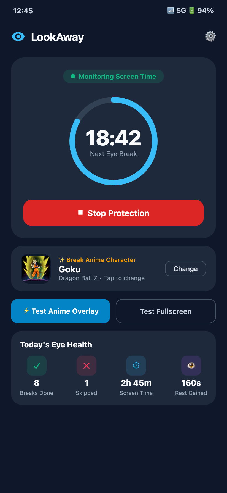
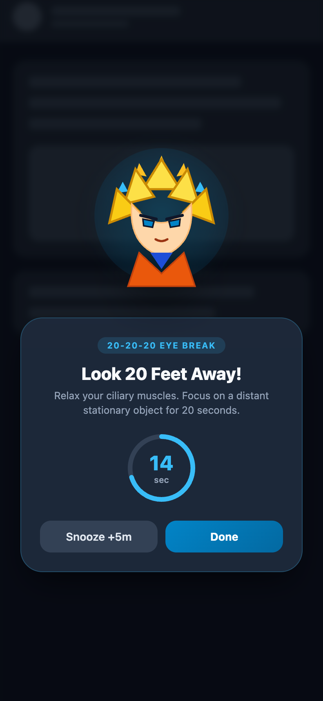

# LookAway 👁️
> **Relieve Digital Eye Strain & Dry Eyes with the 20-20-20 Rule & Floating Anime Breaks**

[](https://github.com/Yashwant00CR7/lookaway/releases/latest)
[-10B981?style=flat-square)](https://developer.android.com)
[](https://kotlinlang.org)
[](https://developer.android.com/jetpack/compose)
[-success?style=flat-square)](#-why-screen-time-tracking-instead-of-camera-iris-tracking)
[](LICENSE)

---

## 📥 Download

👉 **[Download Latest APK (v1.1.0)](https://github.com/Yashwant00CR7/lookaway/releases/latest/download/lookaway-v1.1.0.apk)** *(Direct install on Android 8.0+)*

---

## 📸 Screenshots

| 📱 **Active Dashboard & Timer** | ⚡ **Floating Anime Break Overlay** |
| :---: | :---: |
|  |  |
| *Real-time screen-time countdown, service status, today's eye health metrics, and anime theme selection.* | *Floating transparent character sticker with 20s countdown ring appearing directly over any active app.* |

---

## 🎯 Core Purpose & The Problem

### 👓 The Blue-Ray / UV Glasses Misconception
Many of us experience scratchy, burning, dry eyes and headaches after hours of staring at phones and computers. A widespread misconception (often marketed by optical shops and shared by well-meaning peers) suggests that **"blue light blocking" (blu-ray) glasses** will solve eye dryness and screen fatigue.

Clinical research and the **American Academy of Ophthalmology (AAO)** have repeatedly debunked this myth:
> **Blue light emitted by computer and phone screens does NOT cause ocular dryness or digital eye strain.**

The real biological causes of digital eye strain are two-fold:
1. **Dramatic Drop in Blink Rate (Tear Film Evaporation):**
   - Under normal conditions, humans blink approximately **15 times per minute**.
   - When concentrating intensely on digital displays, our spontaneous blink rate drops by over 60% down to **5–7 blinks per minute**.
   - Without regular blinking, the eye's delicate lipid and aqueous tear film evaporates, exposing the sensitive corneal epithelium to room air and creating severe dryness, redness, and burning sensations.
2. **Ciliary Muscle Accommodation Spasm (Near-Focus Fatigue):**
   - Human eyes evolved to rest at optical infinity (> 20 feet away).
   - Staring at a near screen (30–50 cm) forces the intraocular **ciliary muscles to stay continuously contracted** in an accommodation spasm for hours without relief.

---

### 🔬 The Clinically Proven Solution: The 20-20-20 Rule
Developed by optometrist Dr. Jeffrey Anshel and endorsed by ophthalmologists worldwide:
- **Every 20 minutes** of continuous screen viewing,
- Shift your gaze to a stationary object **at least 20 feet away (6 meters)** (e.g., out a window or down a hallway),
- Keep looking into the distance for **at least 20 seconds**.

Looking into the distance completely releases tension on the ciliary muscles, resets focal accommodation, and triggers deep natural blinks that replenish the corneal tear film.

---

### 🔋 Why Screen-Time Tracking Instead of Camera Iris Tracking?
When conceptualizing an eye-care assistant, a common idea is using the front-facing selfie camera with AI computer vision to track the user's pupils and blink rate. While technically interesting, for real-world daily use this approach has fatal drawbacks:

| Evaluation Vector | Front Camera Computer Vision | LookAway Screen-Time Engine |
| :--- | :--- | :--- |
| **Battery Consumption** | **Severe:** 15%–30% battery drain per hour (camera sensor + continuous neural inference) | **Zero Impact:** < 0.1% battery drain per day (event-driven hardware broadcasts) |
| **Privacy & Security** | Camera stays powered on all day (green privacy LED indicator on, potential recording fear) | **100% Private:** Zero camera, microphone, or biometric permissions requested |
| **Reliability** | Easily fails in low light, tilted angles, lying in bed, or when wearing spectacles | **100% Deterministic:** Screen status is reported directly by the Android OS |
| **Heat & Thermal Throttle** | Causes mobile device to run hot | Device remains completely cool |
| **Passive Natural Breaks** | Cannot reliably tell if user left phone on desk or put in pocket | **Smart Screen-Off Reset:** Detects lock state accurately |

**Verdict:** Event-driven screen-time tracking is dramatically superior, lightweight, and respectful of both battery and privacy.

---

## 🧠 Smart Reset Architecture

LookAway doesn't naively sound alarms every 20 minutes if you were barely using your phone:
- **Screen On:** The foreground service monitors active display time and decrements the timer towards the break interval (default: 20 minutes).
- **Brief Glance / Screen Off < 20s:** If you lock your phone briefly to check something or put it in your pocket for a few seconds, the timer simply pauses. When unlocked, it continues from where you left off.
- **Genuine Rest / Screen Off ≥ 20s:** If your phone remains locked for 20 seconds or longer, your eyes already enjoyed a natural rest! LookAway intelligently resets the 20-minute countdown back to the full 20:00 mark.

---

## ✨ Features

### 🌟 Floating Anime Break Overlay (Over Other Apps)
When 20 minutes of screen time elapse, LookAway doesn't disrupt you with an annoying full-screen interruption or harsh sound. Instead, it renders an **isolated floating character sticker with a transparent background** directly over your current active app (YouTube, WhatsApp, Twitter, games, or browser):
- **Transparent Character Animation:** Curated animated character sticker (no solid opaque box or harsh background).
- **20-Second Progress Ring:** Smooth circular countdown indicator displaying remaining rest time.
- **Quick Controls:** `Snooze (+5m)` if you're in the middle of a critical task, or `Done` when finished.

### 🎭 Curated Famous Anime Character Presets & Custom URLs
Choose your favorite companion to remind you to rest:
- **Goku** (*Dragon Ball Z*) - Super Saiyan focus
- **Naruto Uzumaki** (*Naruto Shippuden*) - Thumbs-up encouragement
- **Monkey D. Luffy** (*One Piece*) - Carefree pirate cheer
- **Anya Forger** (*Spy x Family*) - "Waku waku" cheerful smile
- **Pikachu** (*Pokémon*) - Electric cheer
- **Totoro** (*My Neighbor Totoro*) - Calming nature companion
- 🌐 **Custom Web URL:** Paste any direct URL to a transparent GIF or animated WebP from Giphy, Tenor, or personal storage!

### 📊 Daily Eye Health Analytics Dashboard
Track your daily habits and see your progress:
- **Breaks Taken Today:** Successful 20-20-20 breaks completed.
- **Breaks Skipped / Snoozed:** Instances where breaks were deferred.
- **Screen Time Monitored:** Total cumulative screen time today.
- **Eye Rest Earned:** Total seconds of ciliary muscle relaxation gained.

### ⚙️ Full User Control & Customization
- **Adjustable Work Intervals:** Set your reminder to 15m, 20m, 25m, or 30m.
- **Adjustable Break Duration:** 15s, 20s, or 30s rest periods.
- **Zero-Friction Fallback:** If "Display over other apps" permission is not yet granted, LookAway seamlessly falls back to a full-screen break screen so you never miss a reminder.
- **Harmonic Chime & Haptic Feedback:** Subtle completion chime and gentle haptic pulse when the 20 seconds conclude so you don't even have to look at your screen during your break.
- **Auto-Start on Boot:** Restarts tracking automatically when your device reboots.

---

## 🛠️ Tech Stack & Architecture

- **Operating System:** Android 8.0+ (API Level 26–35)
- **UI Toolkit:** Jetpack Compose with Material 3 Dark Theme
- **Image & Animation Engine:** Coil 2.7.0 (`coil-gif`) for hardware-accelerated animated GIF/WebP decoding
- **Overlay Engine:** Android `WindowManager` with `TYPE_APPLICATION_OVERLAY`
- **Background Execution:** Android Foreground Service with low-priority non-intrusive status notification
- **Lifecycle & Screen Detection:** BroadcastReceiver for `ACTION_SCREEN_ON`, `ACTION_SCREEN_OFF`, and `ACTION_USER_PRESENT`
- **Testing:** JUnit 4 + Kotlin test suite

---

## 🚀 Getting Started

### Method 1: Install Pre-built APK (Recommended)
1. Download `lookaway-v1.1.0.apk` from the [Latest Release](https://github.com/Yashwant00CR7/lookaway/releases/latest).
2. Tap the downloaded file to install on your Android device (enable "Install unknown apps" if prompted).
3. Open **LookAway**, grant the **"Display over other apps"** permission, and tap **Start Tracking**.

### Method 2: Install via ADB
```bash
adb install lookaway-v1.1.0.apk
```

### Method 3: Build from Source
```bash
git clone git@github-personal:Yashwant00CR7/lookaway.git
cd lookaway/android

# Build Debug APK
./gradlew assembleDebug

# Run Unit Tests
./gradlew test
```
The output APK will be located at `android/app/build/outputs/apk/debug/app-debug.apk`.

---

## 📄 License
This project is open-source and available under the [MIT License](LICENSE).

---

*Remember: Every 20 minutes, look 20 feet away for 20 seconds. Your eyes will thank you!* 👁️✨
